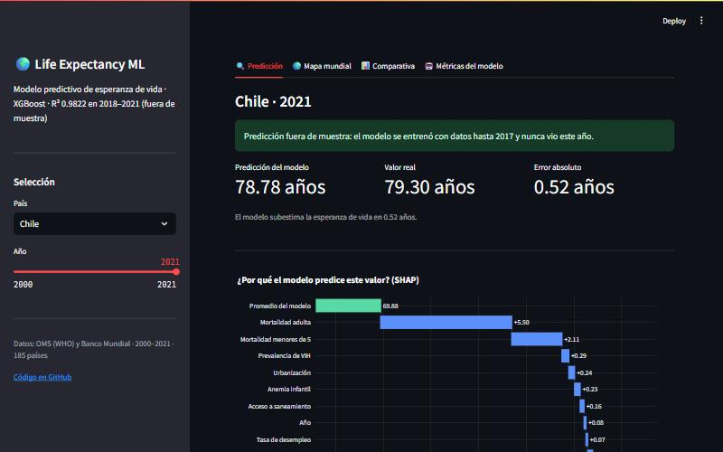
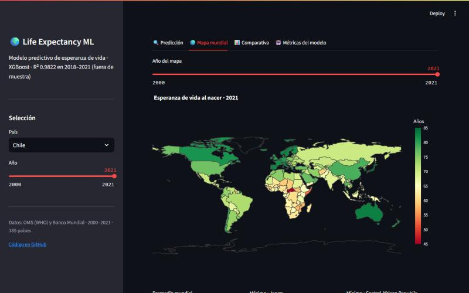
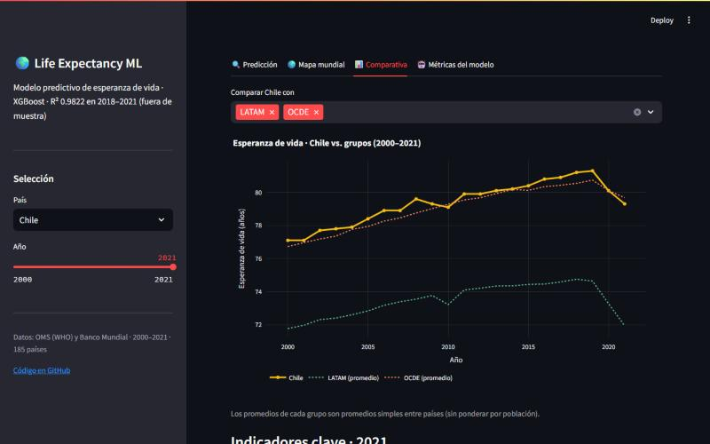

# Life Expectancy ML

[](https://life-expectancy-ml.streamlit.app)


Machine learning model that predicts **life expectancy at birth** for 185 countries using public health and socioeconomic indicators from the **World Health Organization (WHO)** and the **World Bank**, with explainable AI (SHAP) to show *why* the model predicts what it predicts.

**Live dashboard:** https://life-expectancy-ml.streamlit.app



## Key results

| Evaluation | R² | RMSE | MAE |
|---|---|---|---|
| **Temporal split** (train 2000–2017, test 2018–2021) | **0.9822** | **0.974 years** | **0.645 years** |
| Random split 80/20 | 0.9970 | 0.458 years | 0.308 years |

The temporal split is the reference metric: the model predicts years it has never seen, which is how it would be used in practice. The random split is shown for comparison only; it is optimistic because the same country appears in both train and test in neighboring years. Most of the out-of-sample error comes from 2020–2021, when COVID-19 caused sudden drops that the indicators do not capture.

**Most influential features (mean |SHAP|):** adult mortality, under-five mortality, child anemia prevalence and GDP per capita (log).

**Chile:** consistently above the Latin America average and at OECD level (79.3 vs. 72.0 LATAM and 79.7 OECD in 2021). The 2020–2021 drop matches the impact of COVID-19.

## Dashboard

| | |
|---|---|
|  |  |

- **Prediction:** pick a country and year to see the prediction, the real value and a SHAP waterfall explaining each feature's contribution. Years 2018–2021 are true out-of-sample predictions.
- **World map:** life expectancy by country, 2000–2021.
- **Comparison:** any country vs. LATAM, OECD or a world region.
- **Model metrics:** out-of-sample metrics, global SHAP importance and predicted vs. real values.

## Data

| Source | Indicators |
|---|---|
| WHO Global Health Observatory API | Life expectancy (target), under-five and adult mortality, DTP and hepatitis B vaccination, physicians per 10,000, child anemia |
| World Bank API (`wbgapi`) | GDP per capita, health and education spending (% GDP), access to drinking water, sanitation and electricity, unemployment, urbanization, internet users, HIV prevalence (% ages 15–49) |

Final dataset: **4,070 rows · 185 countries · 2000–2021**. WHO values are filtered to both sexes. Countries are merged by ISO-3 code and year; missing values are filled with the last known value of the same country (past only, so the temporal evaluation stays clean) and then with the median of their UN region and year.

## Methodology

1. **Data collection:** WHO GHO REST API and World Bank API (`src/collect_data.py`).
2. **Preprocessing:** merge, ISO-3 validation, UN region mapping and grouped imputation (`src/preprocess.py`).
3. **EDA:** distributions, correlations, temporal trends and Chile vs. LATAM vs. OECD (`notebooks/02_eda.ipynb`).
4. **Modeling:** Linear Regression baseline, Random Forest and XGBoost compared with 5-fold cross-validation; XGBoost tuned with GridSearchCV (`notebooks/03_modeling.ipynb`).
5. **Explainability:** global and local SHAP analysis (beeswarm, bar and waterfall plots).
6. **Dashboard:** Streamlit app served by a model trained only on 2000–2017 (`src/train_model.py`, `dashboard/app.py`).

## Project structure

```
life-expectancy-ml/
├── dashboard/app.py            # Streamlit dashboard
├── data/processed/             # Final dataset (raw data is not versioned)
├── docs/img/                   # README screenshots
├── models/
│   ├── best_model.pkl          # Notebook model (random split)
│   └── dashboard_model.pkl     # Dashboard model (temporal split)
├── notebooks/                  # 01 data collection · 02 EDA · 03 modeling + SHAP
├── src/                        # collect_data.py · preprocess.py · train_model.py
├── requirements.txt            # Dashboard dependencies
└── requirements-dev.txt        # Full environment (notebooks + data collection)
```

## How to reproduce

```bash
python -m venv .venv
source .venv/bin/activate        # Windows: .venv\Scripts\activate
pip install -r requirements-dev.txt

python src/collect_data.py       # download WHO + World Bank data
python src/preprocess.py         # build data/processed/dataset_final.csv
python src/train_model.py        # train the dashboard model
streamlit run dashboard/app.py
```

## Limitations

- The period ends in 2021 because the WHO has not published adult mortality, the most important feature, for later years.
- The WHO child anemia series ends in 2019, so 2020–2021 reuse each country's 2019 value.
- About 20% of HIV prevalence values are imputed: 36 countries have no World Bank data, mostly low-prevalence ones.
- Group averages in the dashboard are simple country averages, not weighted by population.

## Author

**Marcelo Adolfo Corro Troncoso**
[GitHub](https://github.com/k1ngdom0fbullsh1t) · [LinkedIn](https://www.linkedin.com/in/marcelo-corro-troncoso-7b576b22b)

## License

MIT. This is an academic portfolio project; it is not health advice and does not represent the views of any institution. Data is public and comes from the WHO and the World Bank.
